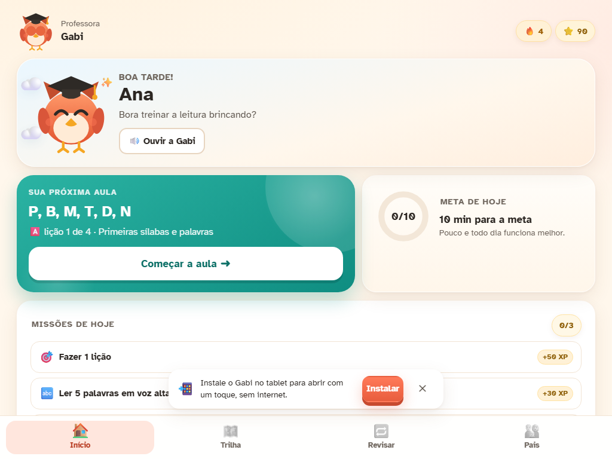
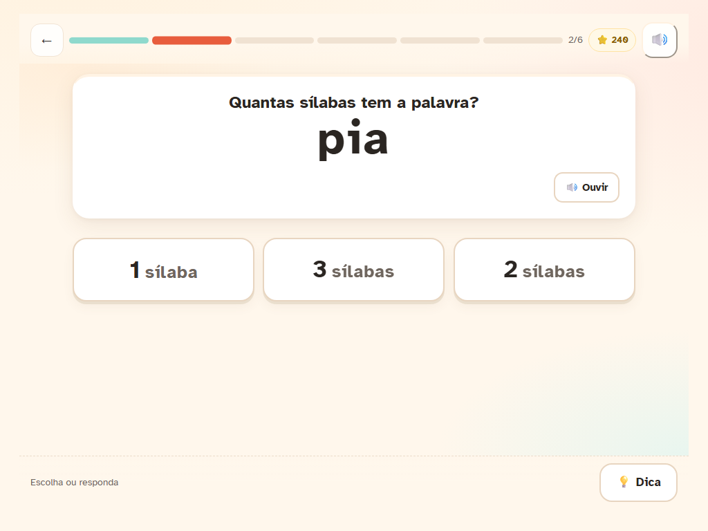
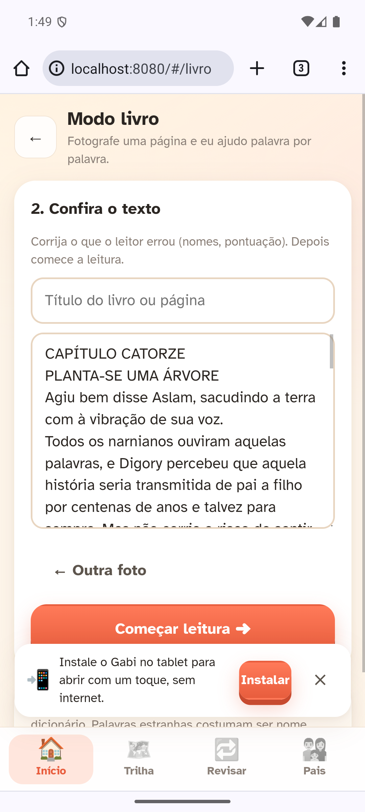
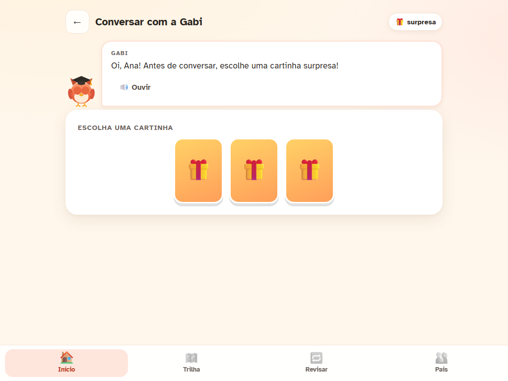

# 🦉 Gabi — ler e escrever no tablet

App de tutoria de **leitura e escrita em português** para criança de 8 anos com dificuldade específica. PWA **offline**, sem cadastro, sem anúncios e sem coleta de dados.

A Gabi é uma coruja professora que **fala, escuta a criança ler em voz alta, corrige com carinho e propõe o próximo passo** — do som das letras a histórias completas. O diferencial é a **leitura guiada sílaba a sílaba**: ela isola o pedacinho que travou, modela e pede para repetir.



> **Estado atual (09/11/2026):** service worker `gabi-v48`, 14 unidades, 22 textos, 351 palavras, 1.778 clipes de áudio (55 MB em MP3, **13 MB em Opus**). O áudio Opus é pré-cacheado na instalação e sobrevive a atualizações. Cada lição termina com uma **revisão rápida** de 2 itens.
> Documentação completa em [`docs/ARQUITETURA.md`](docs/ARQUITETURA.md), ideias em [`docs/BACKLOG.md`](docs/BACKLOG.md) e critérios de qualidade em [`docs/QUALIDADE.md`](docs/QUALIDADE.md).

---

## O que já está pronto

| Área | O que faz |
| --- | --- |
| **Voz** | Clipes neurais ElevenLabs (pt-BR) + voz do tablet como reserva; velocidade e voz ajustáveis. |
| **Escuta** | Reconhecimento em pt-BR com retry real; destaca o que acertou e o que faltou. Nunca pune: “Eu li / Eu repeti” sempre disponível. |
| **Trilha** | 14 unidades em escopo-sequência: sons e sílabas → P B M T D N → F V L R S → C G J X Z → dígrafos → **M antes de P/B** → encontros → finais → histórias. |
| **Níveis** | 3 níveis por fase (assistido → praticando → sozinha) e **fase chefe** com 8 itens misturados. |
| **Exercícios** | 13 tipos: contar sílabas, rima, som inicial, juntar, montar palavra, sílaba que falta, ditado, M/N, leitura de palavra/frase/texto, compreensão. |
| **Modo livro** | Foto da página → OCR com correção de luz e dicionário → conferência → leitura palavra por palavra e por frase. |
| **Leitura guiada** | “Me ensina”: sílaba a sílaba, com microfone e modo “eu repeti”. |
| **Jogos** | Caça-palavras 8×8, baú do dia, adesivos, histórias. |
| **Conversa** | Tema surpresa em 3 cartinhas (flip 3D), humor, sílabas, trava-línguas (21 em 8 temas). |
| **Memória** | Revisão espaçada de 1, 3, 7, 16 e 35 dias **e revisão rápida ao fim de cada lição** (2 itens, priorizando o que a criança errou). |
| **Pais** | Progresso por habilidade, minutos, palavras difíceis, ajustes, PIN, backup/restauração e “baixar todo o áudio”. |
| **Offline** | Depois de instalado, funciona sem internet; só a escuta e o OCR usam rede. |





---

## Colocar no tablet

Guia completo em [`docs/INSTALAR-NO-TABLET.md`](docs/INSTALAR-NO-TABLET.md).

1. **Link fixo (recomendado):** arraste a pasta `app/` em `app.netlify.com/drop` e abra no Chrome do tablet. HTTPS de verdade, instala como app e o microfone funciona.
2. **Túnel rápido:** `start-tunnel.ps1` gera um link `https://….trycloudflare.com` (o PC precisa estar ligado).
3. **Rede Wi-Fi:** `start.cmd` e abra `http://SEU-IP:8080` — tudo menos a escuta.

No Chrome: ⋮ → **Instalar app**.

---

## Rodar e testar

```powershell
node server/serve.mjs                 # http://localhost:8080
node server/serve.mjs 8443 --https    # microfone + instalação PWA

npm test                              # 69 testes (lógica, store, OCR, áudio, encoding, leitura, revisão, conversa, vozes)
node tests/smoke.mjs                  # fluxo real no Chrome + prints
node tests/story-shot.mjs             # dock do microfone na história em 5 viewports
node tests/reading-sim.mjs            # validação da leitura com escuta simulada
node tests/stress-emu.mjs             # stress test no Chrome do emulador (ver docs/STRESS-V48.md)
node tests/lesson-shots.mjs           # lacuna da sílaba + pecinhas repetidas
node tools/check-modules.mjs          # valida todos os módulos
node tools/test-talk.mjs              # cartinhas de tema e respostas
powershell -ExecutionPolicy Bypass -File tools\android-emulator.ps1   # emulador
```

Requisitos: Node.js 20+ apenas para servir/testar. O app não tem dependências.

---

## Documentação

| Documento | Conteúdo |
| --- | --- |
| [`ESTADO.md`](ESTADO.md) | estado atual, métricas canônicas e comandos de validação (`< 80L`) |
| [`MAPA.md`](MAPA.md) | mapa de módulos (`1 linha/módulo`) e armadilhas conhecidas (`< 60L`) |
| [`REJEITADOS.md`](REJEITADOS.md) | decisões e tecnologias descartadas com condição de reabertura (`< 40L`) |
| [`ARQUITETURA.md`](docs/ARQUITETURA.md) | camadas, rotas, estruturas de dados, estado, offline, servidor, dívidas técnicas |
| [`DESENVOLVIMENTO.md`](docs/DESENVOLVIMENTO.md) | ambiente, testes, convenções, checklist de entrega |
| [`BACKLOG.md`](docs/BACKLOG.md) | tudo o que está em pipe, com prioridade |
| [`QUALIDADE.md`](docs/QUALIDADE.md) | responsividade, animações, critérios de aceite |
| [`STRESS-V38.md`](docs/STRESS-V38.md) | stress test v38: 9 falhas e evidências |
| [`STRESS-V41.md`](docs/STRESS-V41.md) | stress test v41: 9 correções e confirmação (53/53) |
| [`STRESS-V42.md`](docs/STRESS-V42.md) | stress test v42: voz do resultado do caça-palavras (58/58) |
| [`STRESS-V44.md`](docs/STRESS-V44.md) | v44: filtro pt-BR, 662 clipes novos e stress |
| [`STRESS-V46.md`](docs/STRESS-V46.md) | v46: enunciados completos, voz feminina e timeout de áudio |
| [`STRESS-V47.md`](docs/STRESS-V47.md) | v47: 28 clipes antigos regravados com Raquel |
| [`STRESS-V48.md`](docs/STRESS-V48.md) | v48: índice versionado e auditoria dos 1.778 |
| [`CONTEUDO.md`](docs/CONTEUDO.md) | currículo (14 unidades, 351 palavras, 22 histórias) |
| [`AUDIO.md`](docs/AUDIO.md) | pipeline ElevenLabs (1.778 Opus/MP3) e manifesto |
| [`AVALIACAO-KOKORO.md`](docs/AVALIACAO-KOKORO.md) | Kokoro local: o que acerta, o que erra e quando usar |
| [`AVALIACAO-PIPER.md`](docs/AVALIACAO-PIPER.md) | Piper local: rápido e leve, mas sem voz feminina pt-BR |
| [`OCR.md`](docs/OCR.md) | como o Modo livro lê a página |
| [`EMULADOR.md`](docs/EMULADOR.md) | testar no Android sem tablet |
| [`PESQUISA-PEDAGOGICA.md`](docs/PESQUISA-PEDAGOGICA.md) | ~25 fontes e decisões pedagógicas |
| [`PESQUISA-TECNICA.md`](docs/PESQUISA-TECNICA.md) | voz, ASR, PWA, offline |
| [`VIABILIDADE-LOJAS.md`](docs/VIABILIDADE-LOJAS.md) | Play, App Store, Microsoft e monetização |
| [`INSTALAR-NO-TABLET.md`](docs/INSTALAR-NO-TABLET.md) | passo a passo no tablet |
| [`GUIA-DA-FAMILIA.md`](docs/GUIA-DA-FAMILIA.md) | como usar no dia a dia |

---

## Estrutura

```
app/                  PWA estática (sem build)
  index.html
  manifest.webmanifest
  sw.js               service worker (gabi-v48)
  css/                app.css (base/componentes) + game.css (jogo)
  js/                 25 módulos ES (telas, domínio, infraestrutura)
  audio/              1.116 clipes + index.json + opus/ (index-opus.json)
  fonts/ icons/
server/serve.mjs      servidor local (HTTP/HTTPS), sem dependências
tests/                testes de lógica, smoke e prints
tools/                emulador Android, OCR, áudio, corretor, build de listas
docs/                 documentação
```

---

## Limites (importante)

- **Não diagnostica.** Se em 4–6 semanas o progresso não andar, procure a escola e avaliação fonoaudiológica.
- **ASR erra com voz infantil.** A avaliação é tolerante e sempre oferece alternativa manual.
- **Durante a escuta**, o áudio vai para o serviço de fala do Google. Nome e progresso ficam só no tablet.
- **Não substitui** professora, fonoaudióloga ou neuropediatra.

## Próximos passos

Ver [`ESTADO.md`](ESTADO.md) e [`BACKLOG.md`](docs/BACKLOG.md). Prioridades atuais: validar no tablet físico (microfone sem headset e cache Opus 1.116/1.116), palavras cruzadas (3 formatos), monstrinho e publicação nas lojas (TWA Play Store / MSIX).
