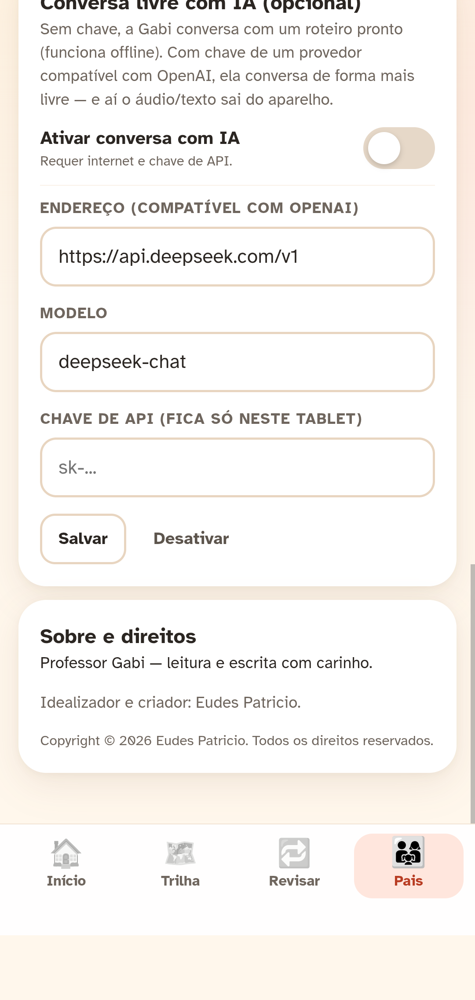

# v49 — Copyright, idealizador e criador

> **Execução:** 09/11/2026 11:14 (America/Sao_Paulo) · **App:** `v49` · **SW:** `gabi-v49`
> **Evidência:** [`tests/stress-v49/18-copyright.png`](../tests/stress-v49/18-copyright.png)

## Resultado

Foi adicionada a seção **“Sobre e direitos”** em **Pais → Ajustes**:

- **Professor Gabi — leitura e escrita com carinho.**
- **Idealizador e criador: Eudes Patricio.**
- **Copyright © 2026 Eudes Patricio. Todos os direitos reservados.**

O cartão fica no fim da aba Ajustes, com hierarquia visual de seção (título, descrição, autoria e copyright).

## Onde mais foi registrado

- [`app/js/version.js`](app/js/version.js): constantes `APP_AUTHOR` e `APP_COPYRIGHT`.
- [`app/index.html`](app/index.html): metadados `author` e `copyright`.
- [`README.md`](README.md): seção **Créditos e direitos**.
- [`app/js/screen-parent.js`](app/js/screen-parent.js): cartão `aboutCard()`.
- Teste de invariante `I9` valida autor, copyright, cartão e metadados.

## Verificação

| Item | Resultado |
| --- | --- |
| Stress completo | **66/66** |
| Seção “Sobre e direitos” | **OK** (screenshot) |
| Unitários Node | **70/70** |
| Invariantes Python | **7/7** |
| `check-opus` | **7/7** |
| Áudio | 1.778 clipes, sem alteração |

## Deploy

- `https://192.168.1.6:8443` — **v49** / `gabi-v49`
- Para o tablet: fechar e abrir a PWA; conferir **Pais → Ajustes**.
- A seção aparece ao rolar até o fim de **Ajustes**.

## Evidência

